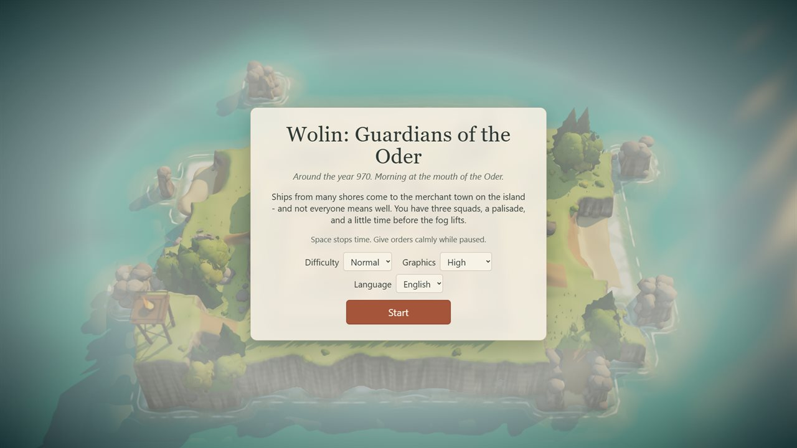
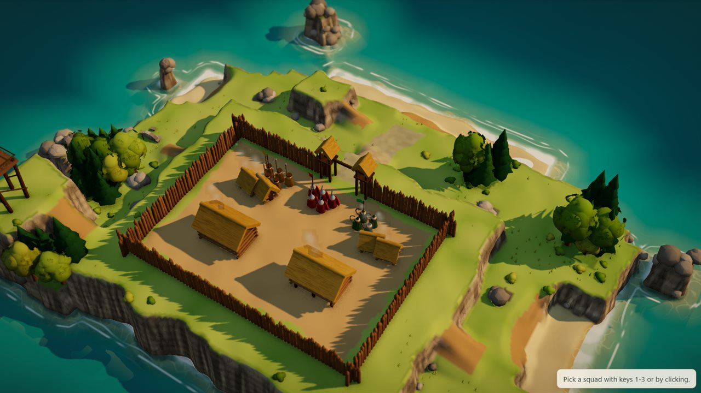
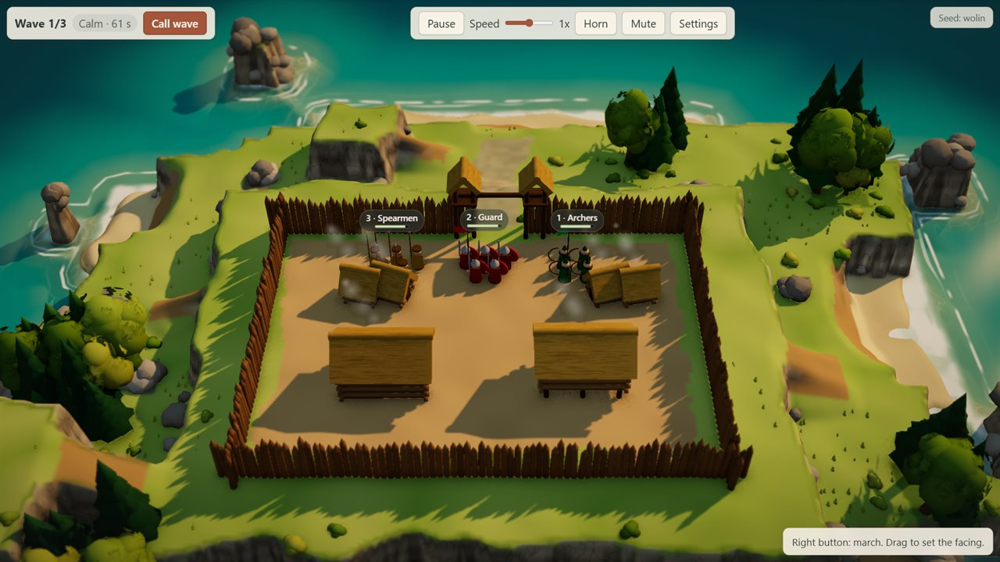
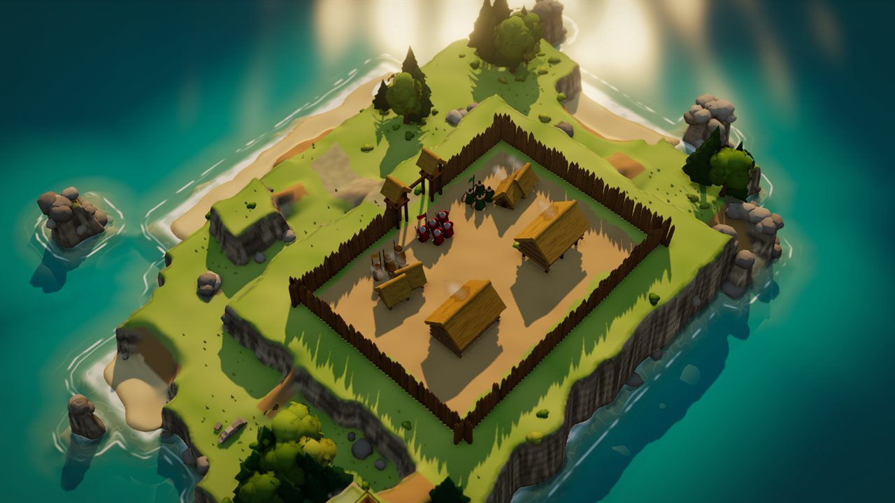
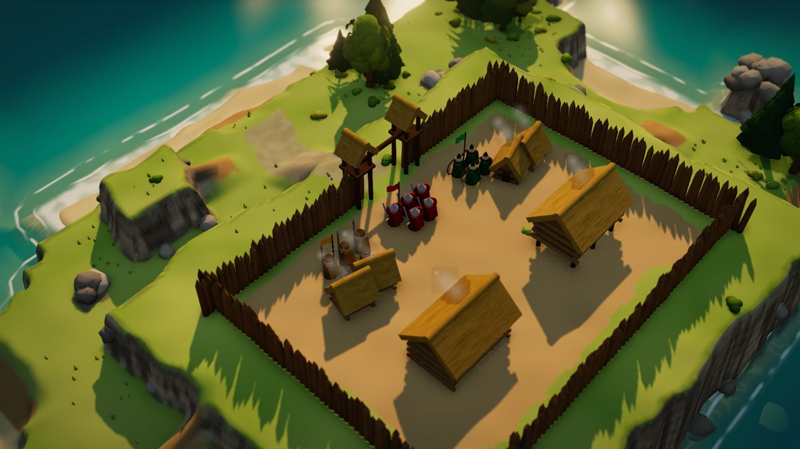
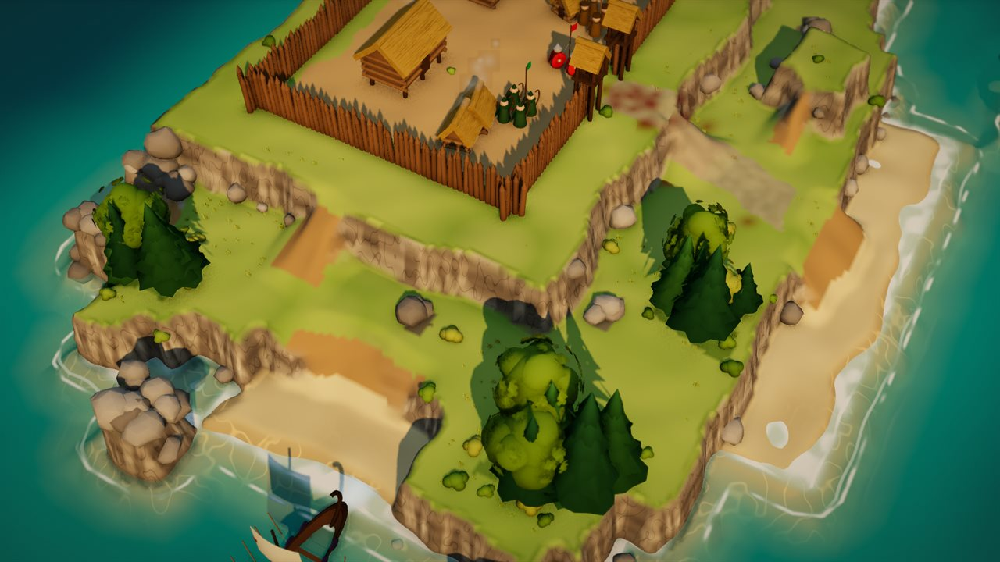
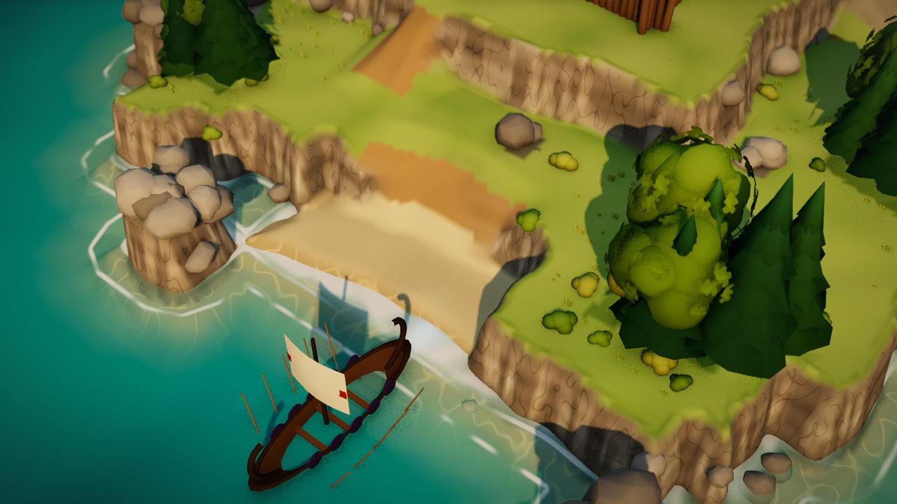
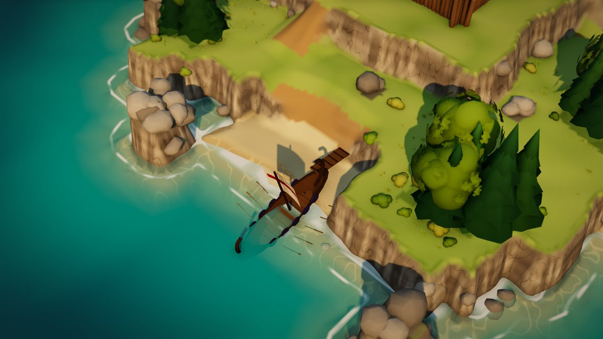
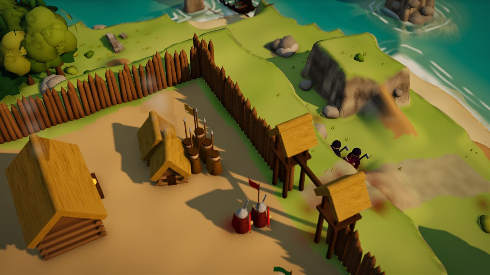

# Wolin: Guardians of the Oder

[](https://github.com/jtargosz/wolin/actions/workflows/deploy.yml)
[](package.json)
[](https://jtargosz.github.io/wolin/)
[](https://nodejs.org/)
[](https://threejs.org/)
[](https://www.typescriptlang.org/)
[](https://developer.mozilla.org/docs/Web/API/WebGPU_API)
[](LICENSE)

**English** · <a href="#po-polsku"> Polski</a>

**A calm real-time tactics game with active pause, played in the browser.** Around the year 970, ships from many shores come to the merchant town of Wolin at the mouth of the Oder, and not everyone means well. You have three squads, a palisade, and a little time before the fog lifts.

### [▶ Play in the browser](https://jtargosz.github.io/wolin/)



## Features

- **Active pause.** `Space` stops time, and every order still works while the game is paused.
- **Three squads.** Guard holds chokepoints and can raise a shield wall. Archers shoot farther and harder from a hill. Spearmen are best on the beach and pierce armor.
- **Three kinds of raiders.** Raiders, raider archers who shoot from the beach, and armored raiders that arrows barely hurt.
- **Terrain matters.** Cliffs, ramps, flanking and morale decide fights. Raiders land in several coves at once, so waiting behind the palisade does not work.
- **Four difficulty levels:** Easy, Normal, Hard and Brutal.
- **English and Polish**, picked from the browser language and changeable in Settings.
- **No asset files.** All graphics, music and sound are generated in code. Rendering uses WebGPU with an automatic WebGL 2 fallback.

## Screenshots

| | |
|---|---|
| <br>The island at the mouth of the Oder | <br>Three squads get ready before the first wave |
| <br>The town on the plateau | <br>Palisade, gate towers and longhouses |
| <br>Cliffs and ramps decide where raiders can climb | <br>A raider boat heads for a cove |
| <br>Landing on the beach | <br>Raiders at the gate |

## How to play

| Action | Input |
|---|---|
| Select a squad | `1`-`3` or left click |
| March, set facing, attack | Right click, right-drag, right click on an enemy |
| Pause | `Space` |
| Shield wall, horn | `F`, `G`, then click on the map |
| Rotate and move the camera | Left-drag or `Q`/`E`, `WASD` or arrows, mouse wheel |

The full list of controls is in Settings in the game.

## Run locally

Requires Node.js 22.12 or newer.

```bash
git clone https://github.com/jtargosz/wolin.git
cd wolin
npm install
npm run dev
```

Then open http://localhost:5173.

| Command | What it does |
|---|---|
| `npm run build` | Type check and production build into `dist/` |
| `npm run preview` | Serves `dist/` at http://localhost:4173 |
| `npm run test` | Runs the tests once |

The build uses relative paths, so `dist/` works on any static host. Opening `dist/index.html` straight from disk (`file://`) does not work, because browsers block ES modules there. Use `npm run preview` instead.

<a id="po-polsku"></a>

##  Po polsku

**Wolin: Strażnicy Odry** to spokojna gra taktyczna czasu rzeczywistego z aktywną pauzą, działająca w przeglądarce. Około roku 970 do kupieckiego grodu na wyspie u ujścia Odry przypływają ludzie z wielu brzegów, i nie wszyscy z dobrymi zamiarami. Masz trzy oddziały, palisadę i trochę czasu, zanim mgła się rozejdzie.

### [▶ Zagraj w przeglądarce](https://jtargosz.github.io/wolin/)

- **Aktywna pauza.** `Spacja` zatrzymuje czas, a rozkazy wydajesz spokojnie w pauzie.
- **Trzy oddziały.** Drużyna zamyka przejścia i stawia osłonę z tarcz. Łucznicy ze wzgórza strzelają dalej i mocniej. Włócznicy są najlepsi na plaży i przebijają pancerz.
- **Trzy rodzaje wrogów:** najeźdźcy, łucznicy wroga i pancerni.
- **Teren ma znaczenie.** O walce decydują klify, rampy, flankowanie i morale.
- **Cztery poziomy trudności:** Łatwa, Normalna, Trudna i Brutalna.
- **Polski i angielski**, wybierane według języka przeglądarki i do zmiany w Ustawieniach.
- **Bez plików z grafiką i dźwiękiem.** Cała grafika, muzyka i efekty powstają w kodzie.

Sterowanie: `1`-`3` wybór oddziału, prawy przycisk marsz i atak, `Spacja` pauza, `F` osłona tarczami, `G` róg. Pełna lista jest w Ustawieniach w grze.

Uruchomienie lokalne (Node.js 22.12 lub nowszy):

```bash
git clone https://github.com/jtargosz/wolin.git
cd wolin
npm install
npm run dev
```

Potem otwórz http://localhost:5173.

## License

[MIT](LICENSE). The only runtime dependency is [three.js](https://threejs.org/) (MIT).
